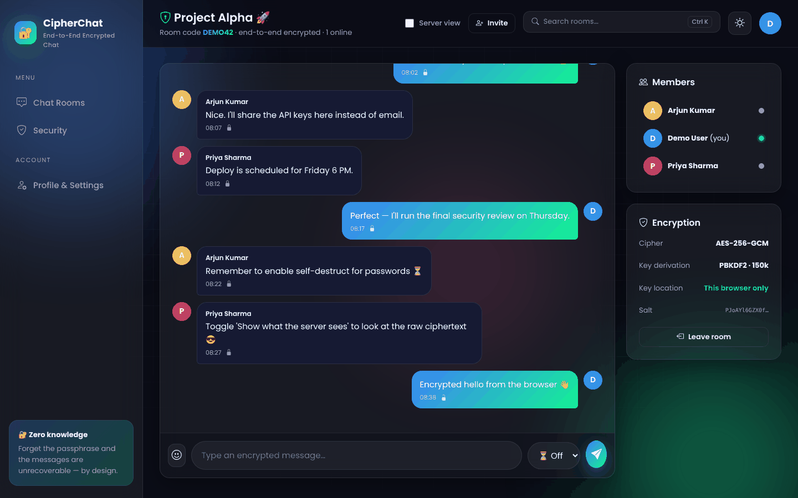
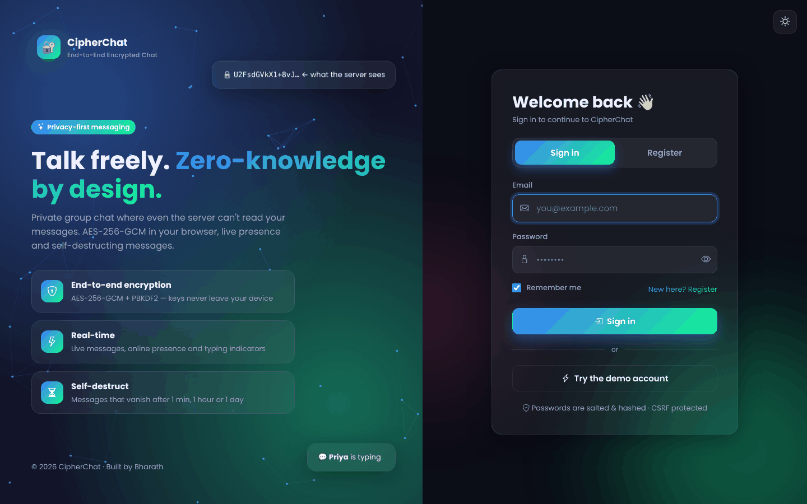
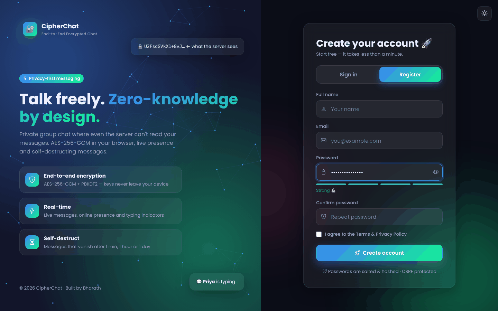
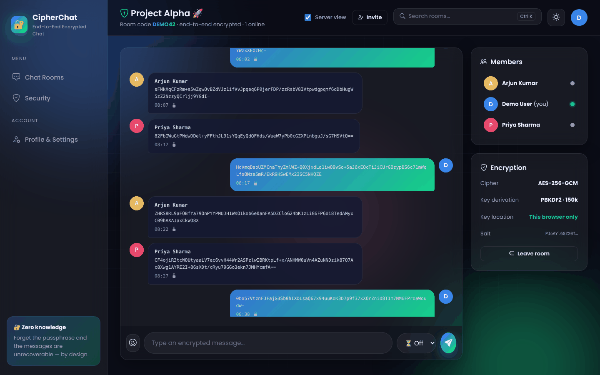
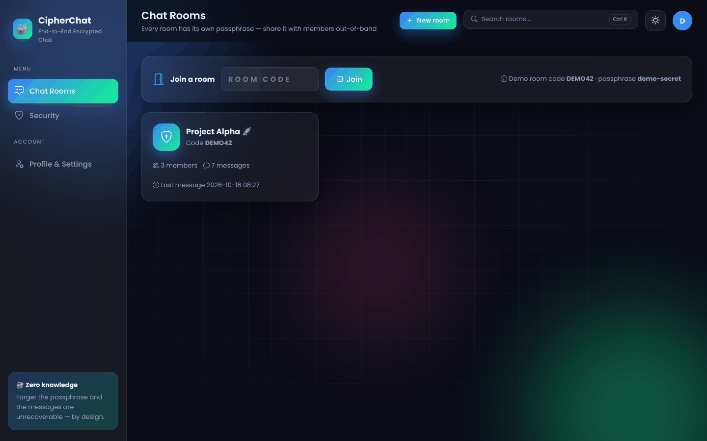
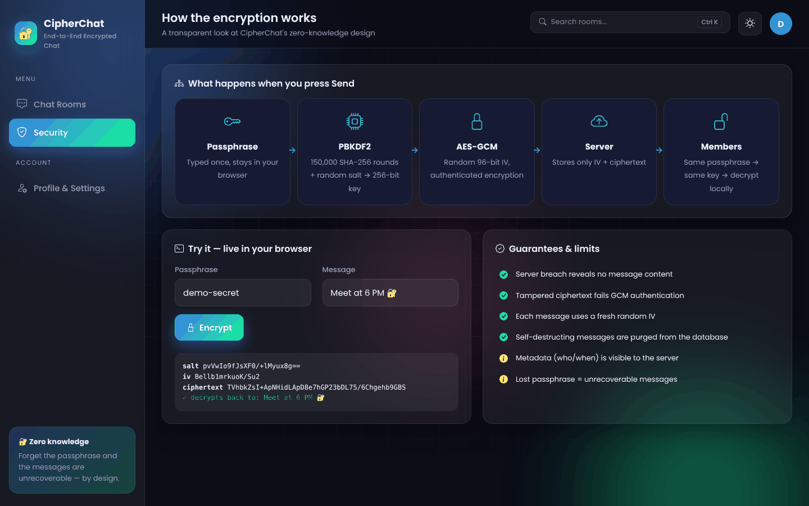
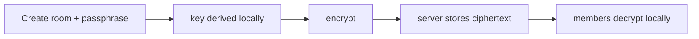

<div align="center">

# 🔐 CipherChat — Real-time End-to-End Encrypted Chat

**Private group chat where even the server can't read your messages: AES-256-GCM in the browser, live presence and self-destructing messages.**

     

`Cybersecurity · Real-time Web` · `Full-stack web app` · `Register / Login` · `Dark & light themes`

</div>

---



## ✨ Features

- **True end-to-end encryption** — PBKDF2 (150k rounds, random salt) → AES-256-GCM with fresh IV per message, all in the browser
- **Zero-knowledge server** stores only IV + ciphertext; passphrase verified via an encrypted check-value
- **Real-time**: new messages, online presence and typing indicators
- **Self-destructing messages** (1 min / 1 h / 1 day) purged from the database
- **'Show what the server sees'** toggle reveals raw ciphertext
- Emoji picker, delete own messages, invite links, interactive **encryption explainer** page

## 🎨 UI / UX highlights

- **Glassmorphism design system** with animated gradient blobs, grid overlay and per-project colour theme
- **Dark / light mode** toggle (remembered per browser) — every chart re-themes instantly
- **Split-screen auth pages** with an interactive particle network, floating cards and a typing "Try demo" button
- **Motion everywhere**: staggered fade-ups, count-up numbers, animated progress bars, ripple buttons, toast notifications, modals
- **Fully responsive** — collapsible sidebar on mobile, Ctrl + K search shortcut
- Works **offline**: Chart.js, Bootstrap Icons and Poppins font are bundled in `static/`

## 🔐 Authentication & security

- **Register / Login / Logout** with salted password hashing (Werkzeug PBKDF2)
- Live **password-strength meter**, show/hide password, "remember me" sessions (14 days)
- **CSRF protection** on every form and API call, brute-force lockout after 5 failed logins
- HttpOnly + SameSite cookies, security headers, per-user data isolation
- **Profile & settings**: edit name, avatar colour, change password, delete account

## 🖼️ Screenshots

| Sign in | Register |
|---|---|
|  |  |

| | |
|---|---|
|  |  |
|  |  |

## 🏗️ How it works



## 🧰 Tech stack

| Layer | Technology |
|---|---|
| Backend | Python 3, Flask, SQLite, cryptography |
| Frontend | HTML5, CSS3 (custom glassmorphism design system), vanilla JavaScript |
| Charts & icons | Chart.js 4, Bootstrap Icons, Poppins (bundled locally) |
| Security | Werkzeug password hashing, CSRF tokens, secure sessions |

## 📁 Project structure

```
CIPHERCHAT-E2E-ENCRYPTED-CHAT/
├── app.py                 # Flask app: routes, business logic & JSON API
├── core.py                # Shared core: app factory, SQLite, auth, CSRF, profile
├── app.py                 # Rooms, members, realtime sync API
├── static/crypto.js       # Web Crypto E2E helpers
├── templates/             # Jinja2 pages (auth, base layout, feature pages)
├── static/                # style.css, main.js + bundled Chart.js, icons & fonts
├── assets/                # README screenshots
├── requirements.txt
└── LICENSE
```

## 🚀 Run it locally

```bash
git clone https://github.com/PreciousBharath/CIPHERCHAT-E2E-ENCRYPTED-CHAT.git
cd CIPHERCHAT-E2E-ENCRYPTED-CHAT
python -m venv venv && source venv/bin/activate      # Windows: venv\Scripts\activate
pip install -r requirements.txt
python app.py
```

Open **http://127.0.0.1:5000** → click **"Try the demo account"** (`demo@example.com` / `Demo@1234`) or register your own account.
The SQLite database is created automatically in `instance/` and seeded with realistic demo data.

Demo room code **DEMO42**, passphrase **demo-secret**. Web Crypto requires `localhost`/`127.0.0.1` or HTTPS.

## ⚙️ Production tips

- Set a strong `SECRET_KEY` environment variable and run behind **gunicorn** / **waitress** with HTTPS
- `DATABASE=/path/to/app.db` overrides the database location

## 👨‍💻 Author

**Bharath** — Software Developer · Project Engineer · Technical Trainer

[](https://linkedin.com/in/connectbharath)
[](https://itsbharathportfolio.netlify.app)
[](https://github.com/PreciousBharath)

⭐ If you like this project, please give it a star!

## 📄 License

Released under the [MIT License](LICENSE).
